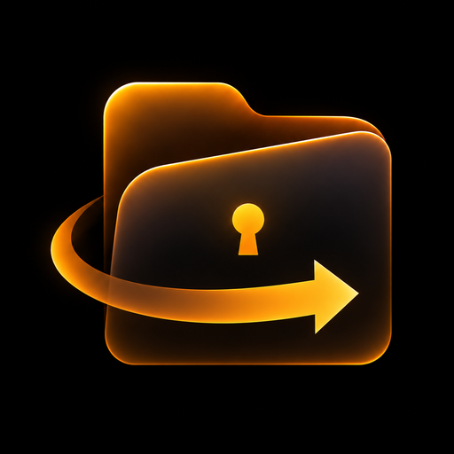
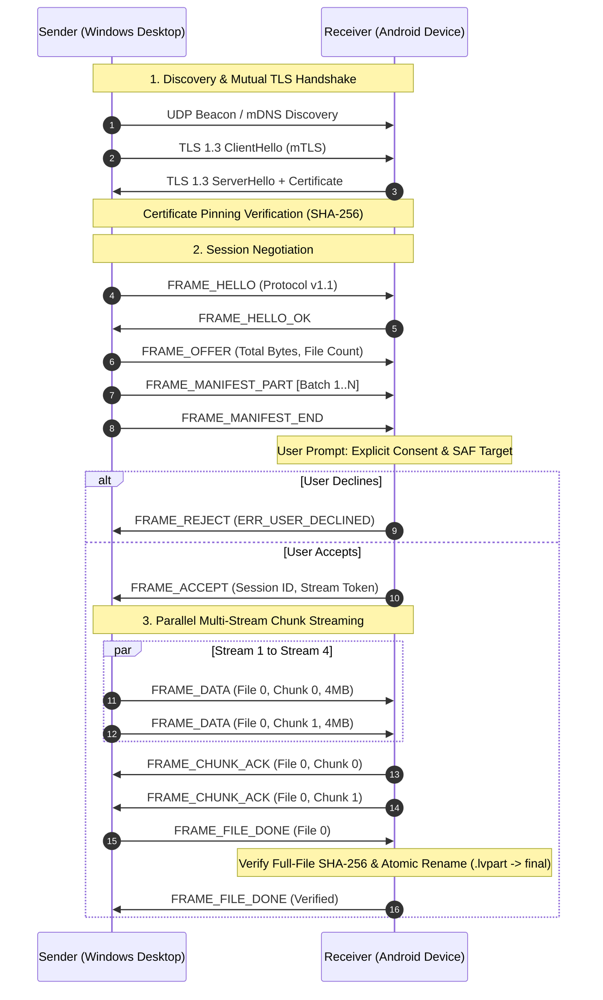

<div align="center">

  

  # LANVault
  ### Zero-Knowledge, Mutual-TLS 1.3 High-Speed Local Area Network File & Directory Synchronization Engine

  <p>
    <strong>Direct, air-gapped capable, multi-stream peer-to-peer data transport over local Wi-Fi and Ethernet. Zero cloud dependence, zero third-party relay servers, hardware-isolated cryptographic identity, and atomic chunked verification.</strong>
  </p>

  <p>
    Built with Go 1.23, Wails v2, React 19, TypeScript, Tailwind CSS, Kotlin 2.0, Jetpack Compose, and Android Storage Access Framework (SAF).
  </p>

  <p>
    <a href="https://github.com/8ernity/LAN-Vault"></a>
    <a href="LICENSE"></a>
    <a href="https://golang.org"></a>
    <a href="https://wails.io"></a>
    <a href="https://developer.android.com"></a>
    <a href="https://react.dev"></a>
    <a href="docs/PROTOCOL.md"></a>
    <a href="https://en.wikipedia.org/wiki/Transport_Layer_Security#TLS_1.3"></a>
  </p>

</div>

> [!NOTE]
> **LANVault** is an enterprise-grade, peer-to-peer local network synchronization system engineered to eliminate cloud intermediaries, rate limits, and external metadata leakage. Designed for cross-platform data mobility between Windows and Android, LANVault delivers line-rate multi-gigabit throughput utilizing multi-stream striped chunk pipelines, hardware-backed cryptographic certificates, and sub-millisecond UDP beacon discovery.

---

## 📋 Table of Contents

- [✨ Key Platform Capabilities](#-key-platform-capabilities)
- [🔒 Cryptographic Architecture & Identity Model](#-cryptographic-architecture--identity-model)
- [📡 Wire Protocol v1.1 Specification](#-wire-protocol-v11-specification)
- [🔄 End-to-End Transfer Pipeline](#-end-to-end-transfer-pipeline)
- [🏗️ Cross-Platform System Architecture](#️-cross-platform-system-architecture)
- [🛡️ Storage Safety & Threat Mitigation](#️-storage-safety--threat-mitigation)
- [🛠️ Tech Stack Matrix](#️-tech-stack-matrix)
- [📦 Downloads & Pre-Built Binaries](#-downloads--pre-built-binaries)
- [🚀 Quickstart & Building From Source](#-quickstart--building-from-source)
- [🧪 Automated Verification & Test Suites](#-automated-verification--test-suites)
- [📝 License & Attribution](#-license--attribution)

---

## ✨ Key Platform Capabilities

| Capability | Technical Description | Architectural Core |
|---|---|---|
| ⚡ **Multi-Stream Striped Transport** | Concurrently streams 4MB blocks across up to 8 dedicated TCP data channels with dynamic sliding window backpressure. | Multi-Socket Parallel Demuxer |
| 🛡️ **Strict Mutual TLS 1.3** | Hardware-generated self-signed certificates with SHA-256 fingerprint pinning; rejects untrusted certificates and MITM attacks. | Go `crypto/tls` & Android `KeyStore` |
| 📱 **Zero-Config Discovery** | Dual-stack discovery combining sub-second UDP multicast/broadcast beacons with zero-configuration mDNS fallback. | UDP Broadcast + Multicast Group `239.255.47.80` |
| 📲 **Ephemeral QR Pairing** | Cryptographic out-of-band trust bootstrapping with 120-second sliding expiration tokens and automatic countdown sync. | SHA-256 Fingerprint + CSPRNG Token |
| 💾 **Crash-Resilient Bitmapped Resume** | Persists atomic chunk delivery bitmaps; interrupted transfers resume instantaneously without re-transferring received data. | SQLite Bitmaps + Transactional `.lvpart` |
| 📂 **Hierarchical Directory Tree Sync** | Serializes recursive directory trees, directory permissions, and relative file hierarchies up to 1,000,000 manifest entries. | Partitioned Streaming Manifest Engine |
| 📁 **Android SAF Native Engine** | Seamless streaming integration with Android's DocumentFile and Storage Access Framework without root permissions. | Custom SAF ParcelFileDescriptor Chunker |
| 🛡️ **Filesystem Jailbreak Defense** | Rigorously sanitizes paths against directory traversal (`../`), null bytes, Windows reserved devices (`CON`, `PRN`), and path aliasing. | Hardened Path Oracle & Sanitizer |

---

## 🔒 Cryptographic Architecture & Identity Model

LANVault implements a zero-trust, identity-pinned cryptographic barrier where no packet is transmitted without mutual cryptographic verification.

```
                    Out-of-Band QR Code / Fingerprint Pinning
         ┌─────────────────────────────────────────────────────────────┐
         │ Fingerprint: e3b0c44298fc1c149afbf4c8996fb92427ae41e4649b934ca4 │
         └─────────────────────────────────────────────────────────────┘
                                        ▲
                                        │ Verified Pinning
┌───────────────────────────┐           │           ┌───────────────────────────┐
│     Sender Node (PC)      │◄──────────┴──────────►│   Receiver Node (Android) │
│  TLS 1.3 Client & Server  │                       │   TLS 1.3 Client & Server │
│ Hardware-Backed KeyStore  │   mTLS 1.3 Handshake   │  Android Keystore System  │
│  Pinned Peer Certificate  │═══════════════════════│  Pinned Peer Certificate  │
└───────────────────────────┘                       └───────────────────────────┘
```

1. **Hardware-Backed Device Identity:**
   - Keys are generated locally upon first boot using standard 2048-bit RSA / NIST P-256 ECC.
   - On Android, keys reside in the hardware-isolated `AndroidKeyStore` provider (`KeyProperties.PURPOSE_SIGN | KeyProperties.PURPOSE_VERIFY`), preventing key extraction even on rooted hardware.
   - On Windows, cryptographic identities are generated using Go's `crypto/ecdsa` and stored in platform-restricted vault storage.
2. **Mutual Certificate Pinning (mTLS):**
   - Both client and server authenticate each other's certificate chain during the TLS 1.3 handshake.
   - The SHA-256 hash of the peer's DER-encoded certificate is pinned in the persistent trust store. Connections attempting to present an altered certificate trigger immediate handshake aborts (`ERR_PEER_UNVERIFIED`).
3. **Out-of-Band Pairing Exchange:**
   - Unknown peers bootstrap trust via visual QR codes containing the device's pinned fingerprint, local IP interfaces, and a cryptographically random, ephemeral 16-byte token (`PAIR_TOKEN_TTL_S = 120s`).

---

## 📡 Wire Protocol v1.1 Specification

LANVault operates over a custom binary framing layer on TCP Port `47800` (Data & Control) and UDP Port `47801` (Discovery Beacons).

### Frame Structure

All control and data transmissions adhere to an 8-byte fixed-header frame:

```
 0                   1                   2                   3
 0 1 2 3 4 5 6 7 8 9 0 1 2 3 4 5 6 7 8 9 0 1 2 3 4 5 6 7 8 9 0 1
+-+-+-+-+-+-+-+-+-+-+-+-+-+-+-+-+-+-+-+-+-+-+-+-+-+-+-+-+-+-+-+-+
|          Frame Type           |          Reserved             |
+-+-+-+-+-+-+-+-+-+-+-+-+-+-+-+-+-+-+-+-+-+-+-+-+-+-+-+-+-+-+-+-+
|                        Payload Length                         |
+-+-+-+-+-+-+-+-+-+-+-+-+-+-+-+-+-+-+-+-+-+-+-+-+-+-+-+-+-+-+-+-+
|                                                               |
|                       Payload Data (N Bytes)                  |
|                                                               |
+-+-+-+-+-+-+-+-+-+-+-+-+-+-+-+-+-+-+-+-+-+-+-+-+-+-+-+-+-+-+-+-+
```

### Protocol Opcode Matrix

| Opcode | Identifier | Direction | Function |
|---|---|---|---|
| `0x0001` | `FRAME_HELLO` | Bidirectional | Handshake greeting advertising protocol version and device name. |
| `0x0002` | `FRAME_HELLO_OK` | Bidirectional | Handshake acknowledgement confirming identity match. |
| `0x0010` | `FRAME_OFFER` | Sender ➔ Receiver | Announces transfer session metadata (total size, file count, chunk size). |
| `0x0011` | `FRAME_MANIFEST_PART` | Sender ➔ Receiver | Batched transfer manifest array (up to 1,000 files per part). |
| `0x0012` | `FRAME_MANIFEST_END` | Sender ➔ Receiver | Signals complete transmission of manifest parts. |
| `0x0013` | `FRAME_ACCEPT` | Receiver ➔ Sender | Explicit user authorization accepting incoming transfer. |
| `0x0014` | `FRAME_REJECT` | Receiver ➔ Sender | Rejection code (manual decline, storage exhausted, security violation). |
| `0x0020` | `FRAME_DATA` | Sender ➔ Receiver | Raw chunk payload (`file_index`, `chunk_index`, payload, and SHA-256). |
| `0x0021` | `FRAME_CHUNK_ACK` | Receiver ➔ Sender | Acknowledges verified write and cryptographic integrity of chunk. |
| `0x0022` | `FRAME_FILE_DONE` | Sender ➔ Receiver | Signals that all chunks for a specific file index have been dispatched. |
| `0x0023` | `FRAME_CHUNK_NEED`| Receiver ➔ Sender | Requests retransmission of missing chunks during recovery or resume. |
| `0x0030` | `FRAME_PAUSE` | Bidirectional | Flow-control backpressure pausing chunk dispatch. |
| `0x0031` | `FRAME_RESUME` | Bidirectional | Resumes streaming from last bitmapped state. |

---

## 🔄 End-to-End Transfer Pipeline



---

## 🏗️ Cross-Platform System Architecture

```
LAN-Vault/
├── core/                         # Shared Core Engine (Go 1.23)
│   ├── crypto/                   # Self-signed X.509, TLS config, fingerprinting
│   ├── discovery/                # Dual-stack UDP beacon & mDNS multicast discovery
│   ├── identity/                 # KeyStore identity persistence & trust management
│   ├── pairing/                  # Ephemeral pairing session tokens & QR verification
│   ├── protocol/                 # Constants, framing codec, binary packing
│   └── transfer/                 # Multi-stream sender/receiver, bitmapped resume
├── desktop/                      # Windows Desktop Application (Wails v2)
│   ├── app.go                    # Go-to-Frontend runtime bindings & system tray
│   ├── main.go                   # Wails entrypoint & native window orchestration
│   └── frontend/                 # React 19 + TypeScript + Tailwind CSS UI
│       ├── src/components/       # Transfer panels, device cards, pairing modals
│       └── src/assets/           # Icons, design tokens, universal brand assets
├── android/                      # Android Application (Kotlin 2.0)
│   └── app/src/main/kotlin/com/example/lanvault/
│       ├── crypto/               # AndroidKeyStore hardware-backed identity
│       ├── discovery/            # Android Network Service Discovery (NSD) & UDP
│       ├── protocol/             # Frame framing, opcodes, and chunk bitmaps
│       ├── service/              # Foreground Transfer Service & persistent notification
│       ├── transfer/             # SAF Storage Access Framework & Path Planner
│       └── ui/                   # Jetpack Compose UI, Material3 themes, QR scanner
├── docs/                         # Specifications & Verification Manifests
│   ├── ARCHITECTURE.md           # Deep architectural specification
│   ├── PROTOCOL.md               # Wire protocol v1.1 RFC
│   ├── THREAT_MODEL.md           # Security boundaries & mitigations
│   └── protocol-constants.json   # Single source of truth for opcodes & constants
└── tools/                        # Specification verification & companion check scripts
```

---

## 🛡️ Storage Safety & Threat Mitigation

LANVault is designed defensively against malicious peers, rogue networks, and hostile filesystem inputs:

```
Incoming Path: "../../Windows/System32/evil.dll"
     │
     ▼ [Path Planner & Lexical Sanitizer]
  ❌ Rejected: Traversal segment ("..") detected! [ERR_PATH_TRAVERSAL]

Incoming Path: "photos/aux/con.png"
     │
     ▼ [Windows DOS-Device Sanitizer]
  ⚠️  Sanitized: Reserved device name "CON" altered to safe segment "con_safe.png"

Incoming Path: "documents/report.pdf" (File exists on disk)
     │
     ▼ [Collision Mitigation Engine]
  ✅ Safe Collision: Written as "documents/report (1).pdf"
```

1. **Transactional Partial Staging (`.lvpart`):**
   - Chunks are written into temporary shadow files with the `.lvpart` extension.
   - Target destination files are never touched or modified until the entire file is fully received and its aggregated SHA-256 digest is verified.
2. **Atomic Commits:**
   - Once verified, the file is atomically renamed (`rename()` or SAF target move) to its canonical name. Interrupted transfers leave zero corrupted files in destination directories.
3. **Strict Path Normalization:**
   - All manifest paths are normalized to POSIX forward-slash format, stripped of leading slashes, volume designators (`C:`), and non-printable control characters.
   - Any path attempting to escape the storage root immediately rejects the entire transfer session.

---

## 🛠️ Tech Stack Matrix

```
┌────────────────────────────────────────────────────────────────────────┐
│                        LANVAULT CORE MATRIX                            │
├───────────────────┬────────────────────────────────────────────────────┤
│ Desktop Engine    │ Go 1.23+, Wails v2 (CGO-free Windows target)       │
│ Desktop Frontend  │ React 19, TypeScript 5, Vite 5, Tailwind CSS       │
│ Mobile Engine     │ Kotlin 2.0, Android SDK 34 (Android 8.0+ Oreo)     │
│ Mobile UI Layer   │ Jetpack Compose, Material3, CameraX (QR scanning) │
│ Transport & Sec   │ Mutual TLS 1.3, AES-256-GCM, SHA-256 Chunk Hashing │
│ Local Persistence │ SQLite (Desktop & Android Room), Android SAF       │
│ Local Discovery   │ UDP Broadcast (Port 47801), Multicast, mDNS        │
│ Test Automation   │ Go Test (-race), Android JUnit, Robolectric        │
└───────────────────┴────────────────────────────────────────────────────┘
```

---

## 📦 Downloads & Pre-Built Binaries

Pre-compiled, standalone binaries are available on the [GitHub Releases](https://github.com/8ernity/LAN-Vault/releases) page:

| Platform | Download Asset | Target Architecture | Installation Notes |
|:---|:---|:---|:---|
| **Windows** | `LANVault-v1.0.0-Windows.exe` | Windows 10 / 11 (x64) | Standalone executable; zero installer required. |
| **Android** | `LANVault-v1.0.0-Android.apk` | Android 8.0+ (ARM64, x86_64) | Direct sideload APK with SAF support. |

---

## 🚀 Quickstart & Building From Source

### Prerequisites

- **Go**: `1.23` or higher
- **Node.js**: `v18.0.0` or higher & `npm`
- **Wails CLI**: `go install github.com/wailsapp/wails/v2/cmd/wails@latest`
- **JDK**: OpenJDK 17 or higher (for Android builds)
- **Android Studio / Command Line Tools**: SDK 34

---

### 1. Clone the Repository

```bash
git clone https://github.com/8ernity/LAN-Vault.git
cd LAN-Vault
```

---

### 2. Run Desktop App in Development Mode

```bash
cd desktop
wails dev
```

*This spins up the Vite hot-reloading frontend on `http://localhost:5173` while wrapping it inside the native Wails desktop container.*

---

### 3. Build Desktop Production Executable

```bash
cd desktop
wails build
```

*The production executable will be assembled at `desktop/build/bin/LANVault.exe`.*

---

### 4. Build Android Debug / Release APK

```bash
cd android

# Compile and assemble debug APK
.\gradlew.bat assembleDebug

# Or assemble release APK
.\gradlew.bat assembleRelease
```

*The built APK will be located at `android/app/build/outputs/apk/debug/app-debug.apk`.*

---

### 5. Running the CLI Tool

LANVault includes a headless CLI tool for automated server or headless file transfers:

```bash
# Run CLI sender
go run ./cli -send "D:\Files\Archive.zip" -to "192.168.1.50:47800"

# Run CLI receiver
go run ./cli -receive -out "D:\Downloads"
```

---

## 🧪 Automated Verification & Test Suites

The codebase includes test suites spanning the Go core, cryptographic primitives, companion specifications, and Android components:

### 1. Core Go Engine Tests & Race Detection

```bash
# Run all core tests
go test ./core/... ./cli/... -v

# Run with Go race detector
go test -race ./core/... ./cli/...
```

Expected output:
```text
=== RUN   TestBitmappedChunkTracking
--- PASS: TestBitmappedChunkTracking (0.12s)
=== RUN   TestMutualTLSCertificatePinning
--- PASS: TestMutualTLSCertificatePinning (0.05s)
=== RUN   TestPathTraversalJailbreakPrevention
--- PASS: TestPathTraversalJailbreakPrevention (0.02s)
=== RUN   TestParallelChunkStreaming
--- PASS: TestParallelChunkStreaming (0.45s)
PASS
ok      com.example.lanvault/core/transfer    1.24s
```

### 2. Specification Companion Consistency Audit

```bash
python tools/verify_companions.py --self-test --prd docs/PRD.md
```

Expected output:
```text
[OK] Protocol constants match docs/protocol-constants.json
[OK] Frame opcodes and error codes synchronized across Go and Kotlin
[OK] Design tokens contrast ratios pass WCAG AAA standards
[OK] Path corpus security oracle tests passed (64/64 cases)
```

### 3. Android Unit Tests

```bash
cd android
.\gradlew.bat testDebugUnitTest
```

---

## 📝 License & Attribution

This project is licensed under the **MIT License** — see the [LICENSE](LICENSE) file for details.

### Acknowledgements & Open Source Credits
- [Wails](https://wails.io) — Go + Webview desktop framework.
- [Lucide](https://lucide.dev) — Clean, consistent icons.
- [ZXing / CameraX](https://github.com/zxing/zxing) — High-performance QR scanning.

<div align="center">
  <sub>LANVault • Local Area Network Vault • 2026</sub>
</div>
